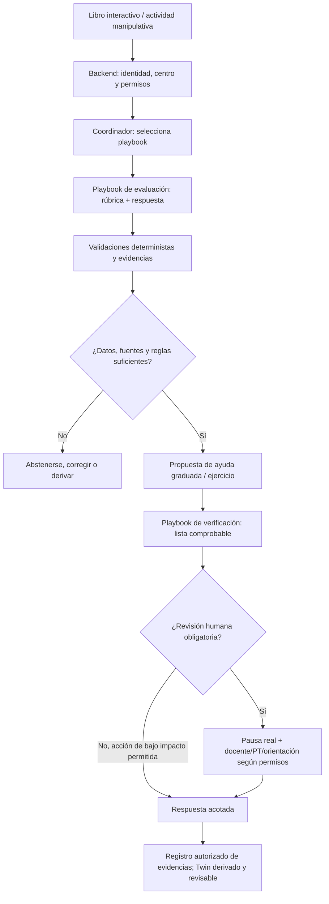

# Decisión arquitectónica — Un agente coordinador con playbooks educativos

**Fecha:** 2026-11-02  
**Estado:** decisión de diseño aceptada; implementación parcial en rama de prototipo.  
**Alcance:** NeuroAula-IA. No implica que exista un orquestador LLM en producción.

## Decisión

En lugar de desplegar de entrada **ocho agentes LLM independientes**, la primera
versión de NeuroAula-IA organizará **un agente coordinador** con playbooks
especializados y herramientas deterministas. Las ocho responsabilidades
educativas definidas anteriormente se mantienen, pero no equivalen a ocho
agentes ni a ocho llamadas al modelo. La arquitectura podrá dividir
responsabilidades en agentes distintos **si una evaluación comparativa posterior
demuestra una mejora** de calidad, seguridad, coste o mantenibilidad.

Un *playbook* es un procedimiento versionado: activación, entradas mínimas,
fuentes autorizadas, pasos, herramientas, condiciones de abstención,
comprobaciones de trabajo terminado, salida tipada y permisos.

## Ocho responsabilidades, no ocho agentes

| Responsabilidad previa | Diseño inicial |
| --- | --- |
| Orquestación | Enrutador central con reglas de decisión, contexto y límites de ejecución. |
| Tutor adaptativo | Playbook de pistas graduadas y siguiente ejercicio. |
| Planificación pedagógica | Playbook de secuenciación, criterios y propuestas al docente. |
| Análisis de evidencias | Playbook de revisión de respuestas, rúbrica, intentos y errores observables. |
| Apoyo metacognitivo | Playbook que promueve explicación, autoevaluación y revisión del procedimiento. |
| Funciones ejecutivas / autorregulación | Playbook de apoyos educativos observables: descomponer tareas, pausas y andamiaje, **sin inferencias clínicas**. |
| Revisión reflexiva | Playbook de contraste con intentos y estrategias previos autorizados, sin atribuir intenciones o capacidades fijas. |
| Verificación pedagógica | Validador de fuentes, coherencia, formato, privacidad, abstención y puerta de revisión humana. |

El enrutador es código de orquestación; la verificación matemática,
los permisos y los límites de privacidad **no deben depender solo de un LLM**.

## Proceso de una actividad

La selección entre pistas y dificultad debe depender de evidencias de
aprendizaje y reglas pedagógicas. **Una respuesta aislada no diagnostica**
TDAH, AACC, dislexia ni otros perfiles.

## Contrato mínimo por playbook

- `id`, `version` y objetivo educativo.
- `trigger` y esquema de entrada tipado; ámbito y permiso.
- Referencias de currículo/actividades y licencia; abstención si faltan.
- Pasos y herramientas autorizadas, con límites de intentos y coste.
- Evidencias observables, clasificación del resultado y grado de incertidumbre.
- Lista de «trabajo terminado» con verificaciones verdaderas/falsas y explicación;
  corregir errores verificables y no ocultar fallos.
- Salida tipada, criterios de escalado y `human_gate`.
- Registro de versión, reglas, fuentes, correcciones y resolución autorizada.

La «autorrevisión» de un LLM no se considera prueba independiente.
Se exigen controles deterministas, pruebas de casos negativos y revisión
docente para decisiones relevantes.

## Libro interactivo y manipulativos

Las interacciones visuales (cajas, balances de ecuaciones, fichas,
arrastrar y soltar) alimentarán los playbooks mediante eventos tipados:
acción, acierto observable, ayuda utilizada, reintento y cambio.
El libro interactivo y los minijuegos no son nuevos agentes.
Se pueden tomar ideas pedagógicas de juegos manipulativos existentes,
pero los símbolos y activos deberán ser originales o usados con licencia.

## Primera implementación y límites

La rama `feat/playbook-agent-educativo-20261102` contiene un primer
**motor de reglas con un playbook de evaluación** en
`src/lib/playbook-agent.ts`, pruebas y una demo local en
`/demo/adaptativo`. Comprueba un ejercicio sintético de números
enteros, elabora una propuesta y la retiene bajo estado de revisión
docente pendiente. **Todavía no hay** agente coordinador LLM,
RAG, registro de evidencias de alumnado, persistencia pedagógica,
integración del libro interactivo ni Human Gate real.

Antes de trabajar con datos de menores: autorización por centro, roles,
RLS, minimización, evaluación de riesgos y cumplimiento aplicable,
ensayos de seguridad y aprobación docente.

## Criterios de decisión para ampliar agentes

Solo considerar un agente independiente cuando un playbook necesite una
capacidad especializada real y medible, por ejemplo, distintas
herramientas/permisos/contexto, paralelismo justificado o requisitos
de aislamiento. Comparar contra la versión más simple mediante
exactitud pedagógica, seguridad, latencia, coste, calidad del feedback,
abstenciones apropiadas y utilidad docente.

## Referencias internas

- [Plan del workshop](WORKSHOP_AI_ENGINEER_PRO_2026-10-27.md)
- [Primer agente con playbook](PLAYBOOK_AGENTE.md)
- [Arquitectura de contexto longitudinal](RLM_ARCHITECTURE.md)

**Nota:** un reel divulgativo puede inspirar esta hipótesis de diseño, pero
no demuestra que un agente con playbooks sea mejor en todos los problemas.
La elección deberá contrastarse con resultados de validación.
