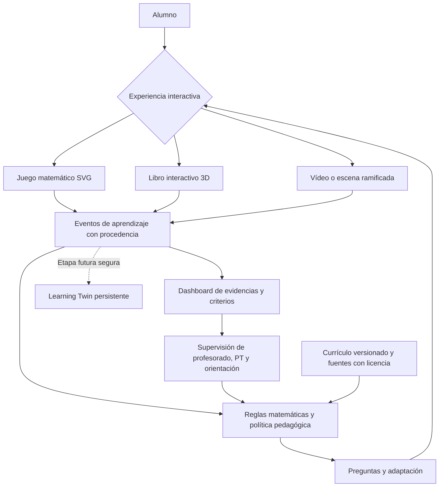

# NeuroAula-IA — Plan maestro de integración

**Consolidación: 31/10/2026. Estado: documento vivo de producto, diseño y ejecución; no implica funcionalidades desplegadas.**

## Visión innegociable

NeuroAula es una **plataforma única** de aprendizaje adaptativo. Sus experiencias pueden adoptar varias formas: **videojuego matemático**, **libro interactivo 3D**, **escena/vídeo ramificado**, **actividad Genially/Newton reinterpretada con licencia**, u otro recurso. Todas deben compartir el mismo contrato: **actividad → interacción → pregunta orientadora → apoyo → nueva prueba → evidencia trazable → adaptación → dashboard → validación profesional**.

El objetivo no es presentar ejercicios con soluciones, sino acompañar al alumno para que **prediga, manipule, explique, compruebe y transfiera**. Los criterios y competencias LOMLOE indican qué aprendizajes observar, y la evaluación formativa informa los siguientes pasos; el docente responsable conserva el juicio evaluador y la calificación, con colaboración de PT y orientación dentro de sus competencias.

## Registro centralizado de ideas acordadas

| Bloque | Visión / decisión | Estado a 31/10/26 |
| --- | --- | --- |
| **Preguntas orientadoras** | Una pregunta útil en cada momento: «¿por qué?», «¿qué cambia?», «¿cómo comprobarías?», con alternativas de representación; no interrogatorio ni respuesta revelada por defecto | Secuencia predefinida propuesta en PR #8, no agente IA real |
| **Evaluación formativa** | Recoger evidencias y actuar durante el aprendizaje; base bibliográfica Morales Lobo y Fernández Fernández, *La evaluación formativa: estrategias eficaces para regular el aprendizaje* (SM, ISBN 9788411201445, prólogo Neus Sanmartí) | Referencia identificada; libro completo no ingerido ni analizado |
| **Videojuego matemático** | Mecánica manipulativa visual → simbólica, como balanza de incógnitas y fichas; inspirada en el enfoque de DragonBox Álgebra 2, **sin copiar sus recursos protegidos** | Especificación de juego, sin balanza programada |
| **Anatomy** | Evaluar su skill como acelerador de SVG/escenas técnicas; no sustituye el motor matemático ni pedagógico | Referencia revisada; **no instalado ni integrado** |
| **Libro interactivo 3D** | **Módulo dentro de NeuroAula, nunca producto aparte**; páginas pop-up con predicción, prueba, desafío y repaso; navegación elegida por el tutor/agente según respuestas y apoyos. Formatos español–árabe A1/A2/B1 y ciencias/matemáticas. | Propuesta por integrar; ejemplo externo identificado y revisado, no integrado |
| **Vídeos/escenas interactivas** | El alumno actúa, manipula y toma decisiones con consecuencias visuales y ramificaciones; más que pausar para responder a un quiz tipo Edpuzzle | Idea especificada; no programada |
| **Genially/Proyecto Newton** | Mapear etapas originales y reexpresarlas en actividades por fases comprender → pensar → ejecutar → responder; conservar fuentes y licencias | Fuentes de referencia por inventariar e integrar |
| **Tutor adaptativo** | Ajustar dificultad según patrones observables, ayudas y transferencia; permitir reformular, repetir, cambiar representación, avanzar y solicitar docente; evitar regla fija de aciertos | Arquitectura documentada; no IA ejecutable |
| **Motor de evidencias y Learning Twin** | Distinguir rendimiento asistido/no verificado de dominio autónomo supervisado; historial mínimo por actividad, criterio, apoyo, explicación, versión y validación profesional | Diseño documentado; sin persistencia educativa real |
| **Dashboard** | Competencias y criterios, fortalezas observadas, dificultades situadas, evolución, apoyos eficaces, siguiente intervención y revisión docente | Tarjetas **ficticias** en rama PR #8; sin métricas reales |
| **PT, orientación y profesorado** | Intervienen con permisos por rol; docente y órganos competentes deciden calificaciones; revisión humana de decisiones de impacto | Diseño; no workflow de revisión real |
| **Offline y acceso** | Recursos locales para centros con conectividad limitada; accesibilidad, TDAH, TEA, dificultades de aprendizaje y barreras lingüísticas sin etiquetas diagnósticas automáticas | Requisito de diseño; no funcionalidad offline garantizada |

## Módulo Libro Interactivo — requisito explícito y prioritario

**No olvidarlo al construir el juego matemático.** Es un segundo formato visual que **consume el mismo sistema de actividades, preguntas, evidencias y evolución**. No crear dos plataformas paralelas.

### Referencia técnica a investigar

Repositorio externo: **[csepulvedai/libro-3d-interactivo](https://github.com/csepulvedai/libro-3d-interactivo)**, skill de Claude Code del Dr. Cristian Sepúlveda-Irribarra. Su README describe libros pop-up 3D en Three.js con páginas, escenas de tinta que se levantan, la progresión *predice → prueba → desafío*, un ejemplo *Ondas y sismos* y exportación a HTML sin conexión. Licencia MIT declarada; antes de copiar código verificar dependencias, procedencia, licencia y compatibilidad. **No se ha incorporado esta skill ni su ejemplo a NeuroAula.** La generación de narración indicada por la skill requiere API, aunque la salida HTML está planteada como offline; distinguir creación y reproducción.

### Experiencias de libro previstas

- **Libro «Ecuaciones que se equilibran»**: una página explica visualmente la igualdad, otra presenta balanza manipulativa, otra propone desafío y otra exige transferencia. El tutor selecciona la página y la siguiente escena; el alumno puede navegar de forma accesible.
- **Libro español–árabe A1/A2/B1**: páginas de vocabulario e imágenes, sonido opcional, lectura, asociaciones, ejercicios graduados y repaso; la navegación depende del desempeño y del tipo de apoyo, no de una etiqueta fija.
- **Libro de ciencias «Ondas y sismos» u otra unidad propia**: predicción de fenómeno, experimento visual, explicación, desafío y vínculo a criterio curricular relevante; material externo solo con permisos.
- **Adaptaciones de acceso**: instrucciones breves, pictogramas, lectura de texto, contraste, teclado/táctil, pausas, estructura predecible, audio controlable, alternativa sin 3D. Separar apoyo de accesibilidad de apoyo conceptual.
- **Despliegue sin conexión**: libro, reglas y ejercicios preparados localmente cuando el centro no tenga Internet; si el agente depende de nube, establecer **modo local de reglas/preguntas predefinidas**, almacenamiento seguro local según política y sincronización autorizada cuando se restablezca conectividad. El modo offline no debe prometer IA de nube sin conexión.

Cada pliego genera eventos del mismo esquema que un videojuego: `module_id, book_id, page_id, activity_id, version, action, question_id, attempt, support_type, evidence_context, criterion_refs, outcome, timestamp`. Para un piloto real, reglas de protección, mínima recogida, autorización y validación previa. El RAG solo puede usar material autorizado y con atribución.

## Una sola arquitectura, varias experiencias

**Arquitectura futura**: interfaz React; motor matemático determinista; agente pedagógico encapsulado; eventos tipados; dashboard con origen de evidencias; Supabase con RLS por centro; RAG curricular versionado; Human Gates. No mezclar estado temporal del juego, eventos persistidos y Learning Twin.

## Primer corte de integración vertical: uno, no ocho agentes a la vez

**Escena demostrable inicial**: `x + 3 = 7`, balanza visual con fichas originales. Acción reversible con ratón/táctil/teclado, feedback matemático determinista, una pregunta orientadora que cambia según la acción y alternativa visual; variante `x + 5 = 9`; evento local tipado; dashboard de un perfil **ficticio** que refleja **esas mismas acciones**, no porcentajes independientes. La revisión docente aparece como hipótesis/propuesta, no calificación automática.

**Reutilización inmediata**: mostrar exactamente el mismo reto y sus preguntas dentro de una **página de libro interactivo** (primero versión 2D/HTML accesible; valorar 3D después), conservando identificadores de actividad y eventos. Eso demostrará que el libro no es un proyecto paralelo.

**Definición de terminado del corte**:
1. El juego y el libro comparten la misma actividad y la misma definición matemática.
2. Interacción real, accesible y reversible; las reglas de equivalencia superan tests.
3. Preguntas y representaciones cambian con la acción; siempre existe opción «no lo sé».
4. Historial local refleja acciones y apoyos; ninguna inferencia inventada.
5. Dashboard muestra los eventos reales **de esta demo local** y el estado pendiente de validación, sin atribuir autoría autónoma.
6. Fuente y licencia de contenidos registradas; ninguna pieza visual copiada de DragonBox.
7. `bun run check` y prueba de flujo completa ejecutados antes de fusionar.
8. No se usan datos reales de menores ni se atribuyen calificaciones o diagnósticos.

## Hoja de ruta sin dispersión

| Orden | Entrega | Dependencias | Estado |
| --- | --- | --- | --- |
| 0 | Revisar PR #8: preguntas orientadoras, dashboard y docs | Tests, accesibilidad y revisión visual | **Abierto como borrador; sin desplegar** |
| 1 | Componente `EquationBalance` matemáticamente probado | Reglas e interfaz SVG accesible | Por hacer |
| 2 | Conectar escena ↔ preguntas ↔ eventos locales ↔ dashboard | Contratos comunes | Por hacer |
| 3 | Añadir primera página del **libro interactivo en NeuroAula**, compartiendo escena y eventos | Hito 2 | Por hacer |
| 4 | Probar adaptación de dificultad acotada y revisión docente con escenarios ficticios | Hitos 2–3 | Por hacer |
| 5 | Analizar reutilización de skill **Anatomy** y **libro-3d-interactivo** para acelerar escenas | Compatibilidad, licencias, accesibilidad y rendimiento | Investigar |
| 6 | Persistencia segura, permisos, auditoría, RLS y Learning Twin | Evaluación de protección de datos y controles de centro | Por hacer |
| 7 | Agente IA/RAG y personalización real | Etapas anteriores validadas | Por hacer |
| 8 | Libro bilingüe español–árabe, fracciones, proporcionalidad, ciencias y vídeo ramificado | Motor compartido y materiales autorizados | Después |

## Política para no perder nuevas ideas

1. Registrar idea en **este documento**, con enlace y fecha.
2. Aclarar formato (*juego/libro/vídeo*), fin pedagógico, criterio, interacción observable, qué registra, qué se adapta y quién revisa.
3. Clasificar **Ahora / Siguiente / Después / Investigar**.
4. Convertir en issue verificable cuando esté lista para construir; no abrir múltiples ramas paralelas sin necesidad.
5. Actualizar estado con PR y pruebas, no presentar documentación como software desplegado.

## Referencias del repositorio

- [Preguntas orientadoras](PREGUNTAS_ORIENTADORAS_EVALUACION_FORMATIVA.md)
- [Juegos y escenas manipulativas](JUEGOS_MANIPULATIVOS_INTERACTIVOS.md)
- [Tutor, evidencias y dashboard](AGENTE_ADAPTATIVO_EVIDENCIAS_Y_DASHBOARD.md)
- [Workshop de agentes y Human Gates](WORKSHOP_AI_ENGINEER_PRO_2026-10-27.md)
- [RLM y Learning Twin](RLM_ARCHITECTURE.md)
- [Evidencia pedagógica](EVIDENCIA_PEDAGOGICA.md)

**Prioridad operativa: menos módulos aislados y más recorridos completos, pequeños y medibles.**
