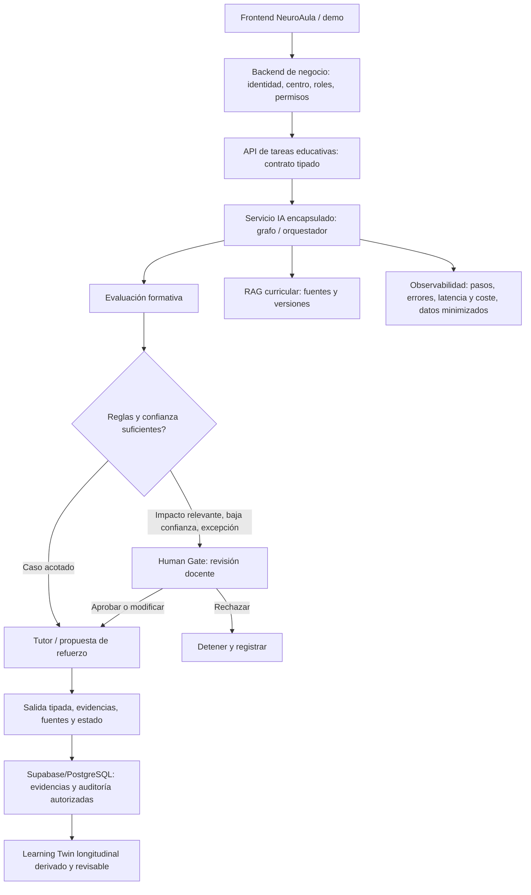

# NeuroAula-IA — Aplicación del workshop AI Engineer PRO (27-10-2026)

**Estado:** propuesta de arquitectura y plan de implementación; NO implica funcionalidades desplegadas.  
**Origen:** notas de la sesión de Antonio Pérez Cano y Álvaro Moya compartidas por la promotora, contrastadas con la documentación existente del repositorio. Algunas diapositivas y detalles de implementación deberán revisarse cuando llegue la grabación y el repositorio de la demo del workshop.

## 1. El principio de diseño

No construir ocho agentes porque se hayan definido ocho nombres. Diseñar primero el **proceso educativo**: problema, entradas, salidas, responsables, datos, decisiones, permisos, controles y métricas. Justificar cada agente por su responsabilidad, herramientas, contexto o nivel de razonamiento. Un nodo del grafo también puede ser **código determinista**, un validador, un recuperador o una puerta humana, sin ser un agente LLM.

Caso de uso inicial: **evaluación formativa de una actividad de matemáticas y propuesta de refuerzo revisable por el docente**. Criterios de éxito verificables: calidad de la clasificación de errores frente a rúbrica humana, trazabilidad de evidencias, abstenciones correctas, tiempo de preparación del docente, permisos/seguridad, coste y latencia.

## 2. Estado verificado de NeuroAula-IA

La aplicación ya dispone de React/TypeScript, TanStack Start, una demo con datos simulados, autenticación Supabase y control de membresías mediante RLS. El README declara expresamente **no implementados**: persistencia educativa, llamadas LLM, agentes ejecutables y RAG. El gemelo de aprendizaje y los indicadores de la demo son simulaciones. Mantener esos avisos hasta que existan implementaciones probadas.

Documentos previos compatibles:
- `docs/RLM_ARCHITECTURE.md`: contexto longitudinal externo, consulta selectiva, Learning Twin como estado consultable.
- `docs/INTEGRACION_MESIAS_LEONARDO.md`: fases, límites de licencias, agentes Alumno/Evaluación/Profesor para el MVP.
- `docs/EVIDENCIA_PEDAGOGICA.md`: cautelas frente a etiquetas fijas o inferencias clínicas.

## 3. Arquitectura objetivo: separar el negocio del servicio IA



**No copiar** literalmente el stack de la demostración de presupuestos de software. Allí se mostraron frontend, backend de negocio, servicio de IA, base de datos, recuperación semántica, modelos, grafo, validaciones y seguimiento. En NeuroAula mantenemos el stack actual y agregamos servicios solo cuando aporten valor. La API podría implementarse en TypeScript o como servicio FastAPI separado, siempre con contratos claros y autenticación de servidor a servidor. Docker Compose es opcional para entornos de desarrollo.

## 4. Estado: elemento central de la arquitectura

La comparación expuesta con el **patrón Redux** ayuda a entender que diferentes procesos comparten una representación de lo que está ocurriendo. En LangGraph un nodo **lee estado y devuelve una actualización parcial**. Los *reducers* definen cómo combinar cambios concurrentes o sucesivos. **No confundir**:

1. **Estado de ejecución del grafo:** datos temporales de una tarea, agente actual, evidencias seleccionadas, clasificación, ruta, validación y errores.
2. **Checkpoints de ejecución:** permiten reanudar un proceso detenido, incluidos Human Gates; tener política de caducidad y aislamiento.
3. **Evidencias persistentes:** eventos de actividades y decisiones revisadas, almacenadas con controles de acceso.
4. **Learning Twin:** representación educativa longitudinal, derivada de evidencias observables y corregible; nunca diagnóstico ni prompt gigante.

Contrato conceptual mínimo, sin identificadores personales innecesarios:
```ts
type EducationGraphState = {
  runId: string;
  organizationId: string;
  studentRef: string; // referencia seudonimizada y autorizada
  activityId: string;
  curriculumCriteria: string[];
  answerRef: string;
  retrievedEvidenceIds: string[];
  errorClassification?: {
    category: "conceptual" | "calculation" | "procedure" | "other" | "uncertain";
    confidence?: number; // métrica solo si validada/calibrada
    rationaleEvidenceIds: string[];
  };
  reinforcementProposal?: {
    activityRef: string;
    rationale: string;
    sourceIds: string[];
  };
  gate?: {
    status: "not_required" | "pending" | "approved" | "modified" | "rejected";
    reviewerRef?: string;
  };
  step: string;
  errors: string[];
};
```

El grafo recibe solo la información mínima y autorizada por tarea. **No poner en su estado expediente, informes médicos ni historial completo del alumno.** No exponer un estado global entre centros ni convertir la confianza generada por un LLM en verdad estadística.

## 5. Nodos, aristas y condiciones

Proceso vertical inicial:
1. Validar sesión, organización, rol y consentimiento/base jurídica pertinentes.
2. Cargar actividad y criterios curriculares.
3. Recoger respuesta y generar una evidencia de intento.
4. Clasificar error con rúbrica y/o modelo, devolviendo campos tipados.
5. Evaluar condiciones deterministas: categoría, incertidumbre, riesgo e impacto educativo.
6. Recuperar fuentes curriculares y evidencias recientes con filtros (RAG/consultas estructuradas).
7. Proponer ayuda o ejercicio graduado.
8. Activar Human Gate antes de acciones educativas sensibles; permitir aprobar/modificar/rechazar, con pausa real en backend.
9. Registrar resultados y fuente/procedencia de la decisión; actualizar solo el estado longitudinal verificado.
10. Devolver respuesta legible para alumno y docente con mecanismos de corrección.

**Aristas:** rutas fijas cuando el orden es conocido; condicionales cuando pueden intervenir revisión humana, abstención, reintento acotado o salida de error. El agente no elige sus permisos.

## 6. Ocho responsabilidades de diseño frente a MVP

La visión de ocho agentes mencionada en las conversaciones se mantiene como **catálogo funcional a validar**, no como ocho procesos necesariamente activos: orquestación; tutor adaptativo; planificación pedagógica; análisis de evidencias; apoyo metacognitivo; funciones ejecutivas/autorregulación; revisión reflexiva; verificación pedagógica.

El plan de MVP ya documentado en el repositorio solo pide inicialmente **Alumno, Evaluación y Profesor**, coordinados por una orquestación. Antes de desplegar agentes adicionales comprobar si cada responsabilidad necesita un LLM, una regla, una herramienta recuperadora, un nodo de validación o un servicio independiente. Revisar los nombres y contratos definitivos de los ocho roles con el diseño original.

## 7. Datos y aprendizaje adaptativo

Tres familias:
- Currículo y materiales: territorio, curso, asignatura, criterio, versión y fuente/licencia.
- Evidencias: actividad, intento, respuesta/resultado, error por rúbrica, ayuda, nueva prueba, fecha, procedencia y validación.
- Intervenciones: propuesta, decisión docente, aplicación, resultado medido y cambio respecto a línea de base.

Los datos deben ser de calidad y representativos del caso de uso. **Patrón detectado no equivale a causalidad ni a diagnóstico.** Empezar con casos sintéticos; no cargar datos identificables de menores en proveedores externos para desarrollar o demostrar el sistema.

En RAG, mantener citas, versiones, calidad de recuperación y respuesta abstentiva cuando faltan fuentes. El Learning Twin no debe reescribirse a partir de una única clasificación no revisada.

## 8. Human Gates y criterio humano

La capa estratégica corresponde a responsables pedagógicos: competencias, políticas, objetivos, rúbricas, decisiones con consecuencias y umbrales revisados. La capa de ejecución prepara opciones y automatiza acciones acotadas.

- Revisión humana obligatoria para adaptaciones significativas, cambios de nivel, evaluaciones oficiales, perfiles sensibles, envío a terceros y decisiones con impacto relevante.
- El servicio de backend suspende y persiste la tarea pendiente; no basta un botón visual.
- Auditar versión de la propuesta, aprobador, motivo, decisión y resultado; autorización antes de reanudar.
- Rechazo, fallo, falta de fuentes o error de autorización deben finalizar de forma segura.

## 9. JEV, LLM y reglas

La charla presentó JEV como posible modelo de decisiones cerradas (clasificación, enrutado, filtrado y priorización); **no es necesario** para el MVP. Compararlo únicamente después con reglas deterministas, un clasificador validado y un LLM con JSON estructurado, sobre un conjunto de pruebas propio. Medir precisión, calibración, sesgos, coste y latencia. Los resultados tipados no implican respuestas correctas.

## 10. Observabilidad

Instrumentar eventos por ejecución y nodo: comienzo/fin, ruta elegida, fuente/evidencia usada, versión del esquema/modelo/prompt, decisión humana, excepción, latencia, coste y resultado. Evitar almacenar texto libre sensible salvo justificación y controles; definir plazos de retención y acceso por roles. Preparar pruebas reproducibles y trazabilidad de cambios.

## 11. Orden de construcción recomendado

**Etapa 0 — Contrato de proceso**: caso de uso, diagrama, entradas/salidas JSON/Zod, permisos, métricas y dataset sintético de validación.

**Etapa 1 — Persistencia segura**: migraciones de evidencias/decisiones; RLS por centro; pruebas de aislamiento y operaciones prohibidas; ninguna tabla con datos reales sin autorización.

**Etapa 2 — Grafo mínimo real**: nodo de validación → clasificador de errores → decisión determinista → propuesta → gate cuando procede → respuesta tipada. Sin ocho LLM simultáneos.

**Etapa 3 — Learning Twin v1**: indicadores reproducibles basados en evidencias y modificaciones docentes; trazabilidad completa.

**Etapa 4 — RAG curricular**: documentos legítimos con versiones y citas; pruebas de recuperación y abstención.

**Etapa 5 — Ampliación multiagente y evaluación**: justificar especialización, agregar agentes de la visión de ocho solo cuando mejoren resultados medidos; comparar con una solución más simple.

**Gates de publicación**: pruebas de tipo, seguridad, autorizaciones, exactitud pedagógica, accesibilidad, coste y revisión humana. Prohibido describir las simulaciones como funcionalidades operativas.

## 12. Trabajo pendiente para contrastar con el material del workshop

- Examinar el PDF, vídeo y repositorio que los organizadores anunciaron que compartirían.
- Confirmar nodos, aristas y transiciones exactas del grafo de la demo de estimaciones de software.
- Revisar el patrón de estado/reducers usado en su código y contrastarlo con la versión de LangGraph seleccionada.
- Observar cómo implementan realmente el Human Gate, persistencia/checkpoints, API y seguimiento.
- Evaluar licencias y viabilidad antes de reutilizar cualquier código ajeno.

## 13. Referencias técnicas

- [LangGraph — State, Nodes, Edges y Reducers](https://langchain-ai.github.io/langgraph/how-tos/multi-agent-network/)
- [LangGraph código fuente: StateGraph](https://github.com/langchain-ai/langgraph/blob/main/libs/langgraph/langgraph/graph/state.py)
- [Redux: estado, acciones y reducers](https://redux.js.org/tutorials/fundamentals/part-1-overview)
- Documentos de NeuroAula en `docs/` y `README.md`.

**Nota de procedencia:** esta especificación refleja aprendizajes e hipótesis de implementación de la sesión. No es una transcripción literal ni una implementación del sistema presentado.
